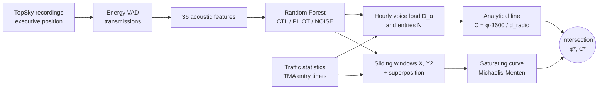
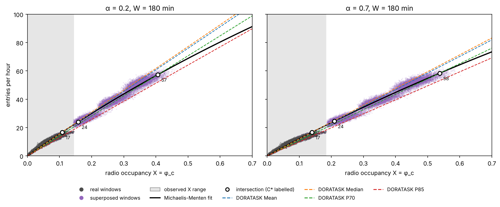
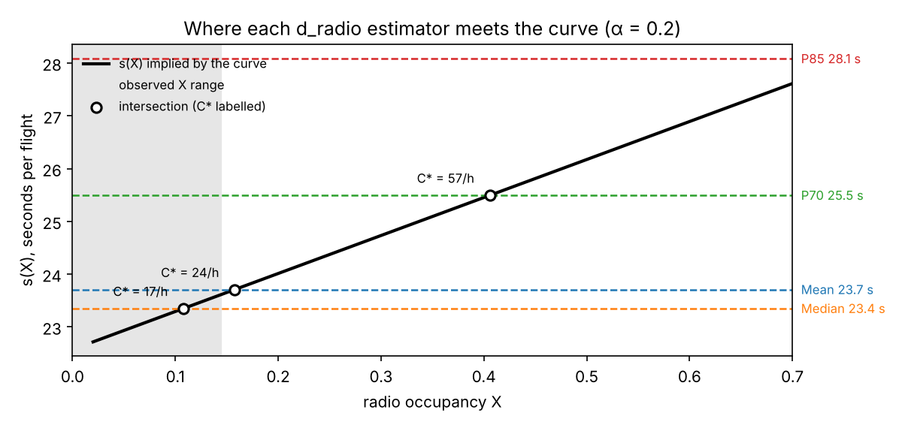

# ATS sector capacity from controller radio recordings

[](https://github.com/MoustaphaRouf/ats-voice-capacity/actions/workflows/ci.yml)

Estimating the capacity of an air traffic control sector usually requires observation campaigns in
the control room: stopwatches, task sheets, expert panels. They are costly and hard to repeat. This
repository replaces them with a continuous, objective measurement already recorded at every
centre: **how much of the time the controller is talking on the radio**.

The pipeline has two stages:

1. **Acoustic classification.** Recordings of the executive radio position are cut into
   transmissions by voice-activity detection, and each transmission is labelled controller, pilot
   or noise by a Random Forest on 36 acoustic features (MFCC, spectral shape, SNR).
2. **Capacity estimation.** Two independent estimates are confronted. An analytical line
   (Audio-DORATASK) gives capacity as a function of the unknown fraction of working time spent
   on voice; an empirical saturating curve (Radio-Traffic) links observed radio occupancy to
   traffic throughput. Their intersection gives both that voice fraction and the capacity, without
   assuming either a priori. This is what makes the method usable on sectors that have never
   been saturated.

Method and results on real data: *ATS Capacity Estimation From Control Center Audio Recordings*,
SSRN, 2026 ([author page](https://ssrn.com/author=3928745)). A web application implementing stage 2
is in [ATS_CAPA](https://github.com/MoustaphaRouf/ATS_CAPA).



## Results on real data (from the paper)

| | |
|---|---|
| Corpus | 695.8 h of approach-control recordings, one month |
| Classifier | 91.7 % accuracy on manually labelled segments |
| Capacity | 19.5 flights/h (P70 service estimator, α = 0.7), about 5 % below the declared 21 flights/h |

The recordings and traffic data are operational data and are **not** included. Everything in this
repository runs on synthetic data generated by the code itself.

## What the synthetic data shows

`atsvc.synthetic.simulate_operations` generates a month of approach-sector operations whose radio
service per flight is known: TMA entries with a daily profile, a single half-duplex frequency
(one speaker at a time), more exchanges per flight when more aircraft are present, 5 % CTL/PILOT
label swaps and spurious noise segments. Running the pipeline on it ([notebook 2](notebooks/02_capacity_estimation.ipynb)):



**The radio service per flight is recovered with a bias of about −9 %**, traceable to the
confidence filter, label swaps and calls made before entry. The tests enforce a 15 % tolerance.

**The intersection needs a diagnostic.** At an intersection, φ*·3600/d_radio = C_emp(φ*), which
rearranges to s(φ*) = d_radio, where s(X) = 3600·X / C_emp(X) is the service per flight implied by
the curve. C* is therefore the throughput at which the fitted service per flight reaches the chosen
estimator. When s(X) is flat, as here, small changes of estimator move C* a long way (17 to 57
flights/h between the median and P70), mostly beyond the observed occupancy range, where the curve
is extrapolated. The package reports this for every intersection (`implied_service`, and the
`extrapolated` flag in `CapacityResult.summary()`).



## Installation

```bash
git clone https://github.com/MoustaphaRouf/ats-voice-capacity
cd ats-voice-capacity
pip install -e ".[audio,excel,dev]"
pytest -q
```

## Usage

**Notebooks** (run from `notebooks/`):

- [01_acoustic_classifier.ipynb](notebooks/01_acoustic_classifier.ipynb) — segmentation, features,
  training and cross-validated evaluation, on synthetic audio. A mechanics check: synthetic classes
  are far easier to separate than real speech, so its score says nothing about real performance.
- [02_capacity_estimation.ipynb](notebooks/02_capacity_estimation.ipynb) — capacity on a synthetic
  month, with the identification diagnostic and the check against ground truth.

**Command line**, on real data:

```bash
atsvc annotate recordings/ --n-files 250        # export segments to listen to + CSV to label
atsvc train to_annotate.csv                     # after filling the 'label' column
atsvc predict recordings/ --out predictions.csv
atsvc capacity predictions.csv traffic.xlsx --start 2024-02-01 --end 2024-02-28
atsvc simulate --out-dir data/synthetic         # synthetic predictions + traffic
```

**Python**:

```python
import pandas as pd
from atsvc import capacity
from atsvc.io import add_absolute_times, load_traffic

pred = add_absolute_times(pd.read_csv("predictions.csv"))
traffic = load_traffic("traffic.xlsx", start="2024-02-01", end="2024-02-28")
res = capacity.estimate_capacity(pred, traffic["t_entry"], alphas=(0.2, 0.7))
res.summary()
```

Input formats are described in [data/README.md](data/README.md).

## Repository structure

```
src/atsvc/
  audio.py        energy VAD and the 36 acoustic features
  classifier.py   annotation export, Random Forest training (stratified CV), prediction
  capacity.py     hourly load, d_radio estimators, DORATASK lines, windows, superposition,
                  Michaelis-Menten / Gompertz fits, intersections, model selection, diagnostic
  io.py           TopSky file-name timestamps, traffic statistics loader
  synthetic.py    synthetic month with known ground truth, synthetic audio corpus
  cli.py          `atsvc` command
notebooks/        two executed demonstration notebooks
tests/            11 tests, run by GitHub Actions
```

## Changes from the original research notebooks

The code was refactored from the Colab notebooks used for the paper (versions V2 to V11.5).

- **VAD edge pairing fixed.** Rising and falling edges were paired by index, which shifted every
  segment when a recording started mid-transmission. Runs are now detected on a padded mask
  (regression test included).
- **No scaler leakage in cross-validation.** Scaling now sits inside a scikit-learn `Pipeline`;
  the confusion matrix comes from out-of-fold predictions on the whole labelled set.
- **Superposition about 50 times faster (measured), same result.** Stacked windows' X and Y2 are sums of the
  individual windows' values, so they are computed from cumulative sums instead of
  second-by-second accumulation. A test checks equality with the original algorithm.
- **Scores on real windows only**, never on superposed ones (as in the paper, now enforced by a test).
- **Intersection diagnostic and extrapolation flag** added.

## Limitations

- Non-vocal workload (monitoring, strip management, coordination by other means) is not captured
  by radio occupancy.
- Superposition assumes the stacked traffics are independent.
- α, the weight of pilot speech in the controller's load, is a field parameter to set per sector.
- φ* is a calibrated quantity: validating it requires targeted observation of a few shifts.
- See the identification diagnostic above before using C* for decisions.

## Résumé en français

Ce dépôt estime la capacité d'un secteur de contrôle à partir des enregistrements radio du poste
exécutif. Une classification acoustique (VAD, MFCC, Random Forest) mesure le temps de parole du
contrôleur et des pilotes ; une droite analytique (Audio-DORATASK) et une courbe empirique
saturante (Radio-Trafic) sont confrontées, et leur intersection fournit à la fois la fraction
vocale φ* et la capacité C*. Les données opérationnelles ne sont pas publiées : tout s'exécute sur
des données synthétiques à vérité terrain connue. Le notebook 2 présente un diagnostic
d'identification à joindre à toute valeur de C*.

## Citation

Moustapha Amadou Roufaï (2026). *ATS Capacity Estimation From Control Center Audio Recordings*.
SSRN. Code: https://github.com/MoustaphaRouf/ats-voice-capacity

## License

MIT
